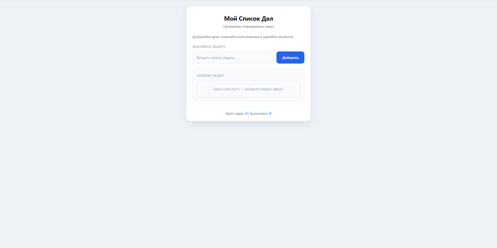

# Мой Список Дел

Простое личное веб-приложение для ведения списка повседневных задач: добавление,
отметка выполнения, удаление. Ванильный HTML/CSS/JS — без сборки, фреймворков и
зависимостей.



## Возможности

- добавление задачи кнопкой или клавишей `Enter` (пустой ввод игнорируется);
- отметка задачи как выполненной — одним кликом по чекбоксу;
- удаление задачи;
- счётчики внизу: всего задач и выполнено;
- сохранение в `localStorage` — список переживает перезагрузку страницы;
- аккуратное пустое состояние, когда задач ещё нет.

Данные лежат в `localStorage` под ключом `todo-list-tasks` в виде массива
объектов `{ text: string, done: boolean }`.

## Запуск

Сборки нет, поэтому достаточно открыть `index.html` в браузере.

Если браузер ограничивает `localStorage` на `file://`, запустите локальный сервер
из папки проекта:

```bash
python3 -m http.server 8000
```

и откройте <http://localhost:8000>.

> Хранилище привязано к origin: у `file://` и у `http://localhost:8000` это
> разные хранилища, поэтому при переключении между ними список будет пустым.

## Структура проекта

| Файл | Назначение |
|---|---|
| `index.html` | разметка экрана |
| `style.css` | все стили, включая состояния задач и пустого списка |
| `script.js` | логика: добавление, отметка, удаление, счётчики, `localStorage` |

Логика в `script.js` не зависит от оформления: скрипт сам создаёт элементы задач
при каждом рендере, поэтому стили задач живут в CSS и цепляются за классы
`.task-text` и `.done`.

## Особенности реализации

- **Ширина экрана фиксирована** — `#app` равен 480px, одна колонка, всё
  рассчитано на один экран без прокрутки. На более узких экранах ширина
  ограничена через `max-width`.
- **Разметка задач генерируется скриптом.** Любая статичная разметка внутри
  `<ul id="taskList">` будет стёрта первым же рендером, поэтому пустое состояние
  сделано через псевдокласс `#taskList:empty`.
- **Класс `.done` ставится только выполненным задачам**, поэтому селекторы
  состояния пишутся как `li.done`, а не «все li минус done».
- Выполненные задаки выделяются приглушённым цветом, а не зачёркиванием.

## Что не поддерживается

Осознанные ограничения, чтобы не создавать ложных ожиданий: редактирование
текста задачи после создания, перетаскивание для сортировки, очистка всех
выполненных задач одной кнопкой.

## Лицензия

Не указана. Если проект нужен открытым, добавьте файл `LICENSE` — GitHub не
покажет его без явного выбора лицензии.